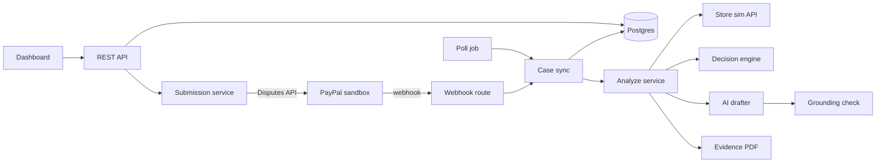
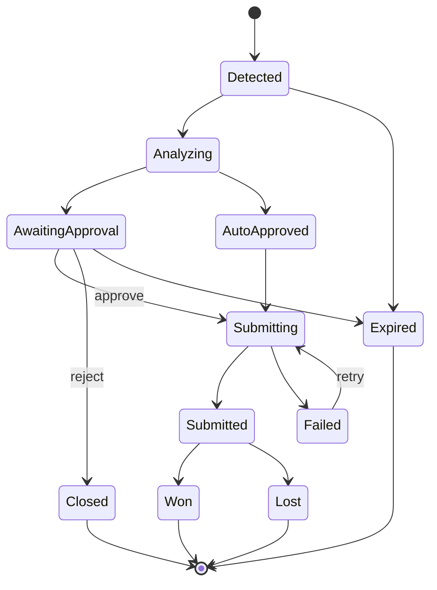

# Rebut: Build Plan

Hackathon: Build What's Next with PayPal and AI. Submissions close Nov 12, 2026.
Plan written Oct 26, 2026. Feature freeze Nov 9. Submit Nov 11.
Team: Kushagra (K), Souptik (S).

## 0. How to use this file

- Read sections 1 to 5 once. Work from section 8 (phases) day to day.
- Claude Code reads `CLAUDE.md` at the repo root. Its contents are in section 14. Copy them there on day one.
- This file is the source of truth. If scope changes, change this file in the same pull request.
- Where a number or claim has a source, it is listed in section 15. Where it is only our judgment, the text says so.

## 1. What Rebut is

Rebut is an AI agent that defends online sellers when a buyer opens a PayPal dispute.

When a dispute opens, Rebut:

1. Reads the case from PayPal (reason, amount, deadline, what PayPal asks for).
2. Collects the proof from the seller's order data (order, tracking, delivery events, store policy).
3. Checks whether the seller can honestly win, and whether fighting is worth the cost.
4. Writes the response using only facts it can point to.
5. Recommends one action: fight, offer a refund, or accept.
6. Submits it through PayPal's Disputes API after the seller approves, or on its own inside limits the seller set.

The seller stays in control. Nothing is sent without approval unless the seller turned on a rule that allows it, and a kill switch stops all autonomy at once.

## 2. The real problem and the gaps

### 2.1 What the numbers say

| Figure | Source | Caveat |
| --- | --- | --- |
| US consumers filed 158 million transaction disputes in 2025, up 29% from 2021, far faster than card transactions grew | Entrepreneur, citing Bloomberg | Card disputes, not PayPal-only |
| Global chargebacks projected around 281 to 286 million in 2026 | chargeback.io and chargebackstop blogs | Vendor blogs; estimates differ slightly |
| US merchants win about 54% of chargebacks they fight, but only about 8.1% of all disputes outright | chargeback.io | Vendor blog. Reading: fighting works, most disputes are never fought |
| Average chargeback costs a merchant about $128 | chargebackstop, chargeback.io | Card data |
| Defending a dispute costs about $82, which pushes some merchants to concede | review42 statistics page | Secondary aggregator |
| 75% of shoppers dispute with the bank without contacting the merchant. When they do contact first, merchants resolve 44% by answering simple questions | chargeback.io | Cites Javelin research |
| Only 17.4% of small businesses feel very informed about chargebacks. 23.5% of merchants use five or more separate tools to investigate disputes or build evidence | Chargebacks911 2026 Field Report, via Chain Store Age | Survey of 250+ merchants, run by a vendor |
| 83.4% of enterprise merchants say friendly fraud rose in three years. Merchants estimate it is 43.8% of their chargeback losses | Chargebacks911 2026 Field Report | Self-reported estimates |
| PayPal Seller Protection for item-not-received needs an online, verifiable tracking number. Item-not-received claims that come from card chargebacks are not covered | PayPal Seller Protection page | PayPal decides eligibility case by case |

PayPal does not publish seller win rates, and we did not find any. Do not quote a PayPal win rate anywhere. Do not quote Rebut's win rate either, because we have no real data behind one.

### 2.2 The gaps Rebut targets

- **G1. Winnable disputes go unfought.** Fighting wins often when evidence is good, but only a small share of disputes are fought at all. Small sellers lack time and tools.
- **G2. Nobody tells the seller if fighting is worth it.** Evidence gathering costs time and money. Sellers need a clear call on fight, offer or accept, with the reason shown.
- **G3. PayPal eligibility is confusing.** Seller Protection depends on verifiable tracking and other rules. Sellers learn they were ineligible after they lose. The Disputes API returns `seller_protection_eligible`, so an agent can check first.
- **G4. The cheapest fix is the least used.** Buyers go to the bank or PayPal first, yet a direct answer settles many disputes. PayPal has an inquiry stage (up to 20 days) built for this.
- **G5. Existing help is closed and paid.** See 2.3.
- **G6. Fake evidence is a risk for any AI here.** An agent that invents tracking details or dates can hurt the seller. Rebut treats this as a core design problem, not an afterthought.

### 2.3 Who already does this

This matters for how we pitch. Commercial tools exist.

| Tool | What it does | Where Rebut differs |
| --- | --- | --- |
| Chargeflow | Automates PayPal inquiries, claims and appeals. Advertises recovering 90% of PayPal disputes. Offers a no-win-no-fee model | Closed SaaS. Results are vendor claims. Not self-hostable |
| Disputifier | AI chargeback responses including PayPal. Advertises up to an 80% win rate | Closed SaaS. Results are vendor claims |
| Solidgate | PayPal representment inside its own payment hub | Only for merchants on that platform |

In our searches we found no open-source option. That is a search result, not proof, so say "we did not find one" and never "there is none".

**Positioning:** Rebut is the open-source, explainable version for sellers who cannot or will not hand their disputes to a paid black box. Every decision shows its rule trace. Every sentence sent to PayPal points to a real fact. The seller sets the limits.

We do not claim to beat the commercial tools on data or win rate. We claim transparency, control and zero lock-in.

### 2.4 Limits of this evidence

- Most statistics come from vendors who sell chargeback services.
- Most are about card chargebacks, not PayPal-native disputes.
- The Reddit and forum signal we found is secondhand.
- The demo uses a seeded fake store and PayPal sandbox cases. It proves the workflow, not real-world win rates.

State these limits in the README. Judges respect honesty more than inflated numbers.

## 3. Product

### 3.1 Users

Small and mid-size online sellers who take PayPal and ship goods or deliver digital products. One seller account per deployment in v1.

### 3.2 Differentiators

- **D1. Rule trace.** Every recommendation lists the rules that fired. No hidden score.
- **D2. Grounding check.** Every claim in the drafted response must cite a stored fact, and the dates, numbers and tracking IDs in the text must match that fact. Failing text cannot be submitted.
- **D3. Honesty guard.** If the seller's own data shows the claim is valid (tracking says not delivered), Rebut will not fight. It recommends a refund.
- **D4. Economics.** A configurable floor tells Rebut when fighting costs more than it saves.
- **D5. Policy-bound autonomy.** The seller can allow automatic action under strict limits, with an audit log and a kill switch.
- **D6. Inquiry first.** At the inquiry stage Rebut can send the buyer a factual tracking message before the case escalates.

### 3.3 In scope

- Item not received disputes end to end (primary).
- Item not as described with refund offers (second).
- Webhook and polling sync, evidence pack with PDF, decision engine, grounded AI drafting.
- Dashboard on AG Grid with approve, edit, reject.
- Seller policy, auto-fight, optional auto-accept (off by default), inquiry message, deadline alerts.
- Audit log, dry-run mode, kill switch.
- Hosted demo on PayPal sandbox with seeded cases.

### 3.4 Out of scope

- Account holds and limits (the Disputes API does not cover them).
- Real money, real stores, multi-merchant onboarding, user accounts beyond one password.
- Predicting win probability.
- Legal advice.

### 3.5 Principles

1. Never invent or alter evidence.
2. A human decides unless the seller wrote a rule that decides for them.
3. Deterministic code makes the decision. The AI writes and explains.
4. Everything is testable offline.
5. Be honest about what the demo proves.

## 4. Awards strategy

I have not seen the official judging criteria. Read the Official Rules and Devpost judging section on day one and update this section. Until then, assume judges weigh technical execution, impact, creativity, demo quality, and meaningful use of PayPal and AI.

| Prize | Amount | What in Rebut earns it | Proof to show |
| --- | --- | --- | --- |
| Best Overall (1st, 2nd, 3rd) | $12,000 / $8,000 / $5,000 | Complete, tested, deployed, documented loop | CI badge, hosted demo, README that runs in 15 minutes |
| Most Impactful | $5,000 | Documented seller pain with sourced numbers and honest limits | Section 2 condensed into the writeup |
| Best Use of PayPal + AI | $5,000 | Many Disputes API calls plus webhooks, with AI that is grounded and checked | Table of API calls used, grounding demo |
| Best Demo Delivery | $5,000 | Scripted 2:30 story with a resettable demo | `pnpm demo:reset`, rehearsed video |
| Best Use of Agentic Commerce | $5,000 | Agent that acts on payments inside seller limits, with audit and kill switch | Policy UI, autonomous case in the demo |
| Most Creative | $5,000 | Honesty guard, grounding check, economics call | One demo moment where Rebut refuses to fight |
| Best Use of AG Grid | $5,000 / $2,000 / 3 x $1,000 | Whole dashboard on AG Grid with custom renderers and charts | Screenshots and a short usage note |
| Best Use of Render | $1,000 / $750 / $500 credits | API, Postgres and scheduled jobs on Render | `render.yaml`, deploy screenshots |
| Best Use of APIMatic | 3 x $1,000 | Context Plugin used while coding the PayPal client | Before and after notes in `docs/tools-used.md` |

Rules to check: whether one team can win more than one prize, and what each sponsor bonus requires. Check what the AG Grid sponsor page expects (the blog post mentions AG Studio) before committing to a specific AG Grid product.

Kernel, Postman, Elastic and Zapier have no bonus prize in the blog post. Use Kernel and Postman only if time allows.

## 5. Architecture



### 5.1 Case lifecycle



PayPal's own fields decide what is allowed. Use `status`, `dispute_life_cycle_stage`, `seller_response_due_date`, `allowed_response_options` and the HATEOAS `links` on the dispute details. Do not hardcode which actions exist.

### 5.2 Decision engine

Pure functions in `packages/core/src/decision`. Same input always gives the same output.

Inputs: the case, the evidence facts, the evidence requirements for the reason, and the seller policy.

Output: `{ action, tier, reasons[], needs[] }`.

Rules, in order:

1. **Deadline.** If the due date has passed, mark Expired. If under the alert window, mark Urgent.
2. **Honesty guard.** If the facts contradict the buyer's claim in the buyer's favor (tracking shows not delivered or returned), action is OFFER_REFUND or ACCEPT. Reason: "Seller data supports the buyer."
3. **Eligibility.** Read `seller_protection_eligible` from the dispute. Record it in the reasons.
4. **Completeness.** Compare requested evidence types with available facts. `completeness = satisfied / required`.
5. **Economics.** If `amount < policy.foldBelowAmount`, action is ACCEPT unless evidence is already complete and policy says always fight.
6. **Choose.**
   - FIGHT when completeness is 1 and the honesty guard is clear.
   - OFFER_REFUND when `allowed_response_options.make_offer` exists and completeness is below 1 and the amount is above the floor.
   - NEEDS_INFO when evidence is partial and time remains.
   - ACCEPT otherwise.
7. **Tier.** HIGH when FIGHT, completeness 1 and eligible. MEDIUM when FIGHT and not eligible. LOW otherwise. This is a rule label, not a probability. Never show it as a percentage.

### 5.3 What the AI does

The model never decides the action. It does four jobs:

1. Drafts the evidence notes (PayPal allows up to 2000 characters).
2. Explains the recommendation in plain language from the rule trace.
3. Drafts the inquiry-stage buyer message.
4. Summarizes the buyer's own message for the dashboard.

Rules for the AI layer:

- Output is structured (tool schema plus zod validation).
- Each paragraph carries `factIds`. Facts come from `EvidenceFact { id, label, value, source }`.
- The grounding checker rejects text when a cited fact does not exist, or when a date, amount or tracking number in the text is not in the cited facts.
- Rejected text triggers one retry with the failure reason, then falls back to a plain template built from the facts.
- Model name comes from `ANTHROPIC_MODEL` (default `claude-sonnet-5-5`). No hardcoded model in code.

### 5.4 Seller policy

```json
{
  "autoFightEnabled": false,
  "autoFightMaxAmount": 50,
  "requireCompleteness": 1,
  "foldBelowAmount": 5,
  "autoMessageBuyers": false,
  "autoAcceptEnabled": false,
  "autoAcceptMaxAmount": 0,
  "alertHoursBeforeDeadline": 24,
  "killSwitch": false
}
```

Autonomy only fires when: the feature is on, the kill switch is off, completeness meets the policy, the honesty guard is clear, the amount is within the cap, and dry-run is off.

### 5.5 PayPal calls used

| Purpose | Call |
| --- | --- |
| Token | `POST /v1/oauth2/token` (cache, refresh 60 s before expiry) |
| List cases | `GET /v1/customer/disputes` |
| Case details | `GET /v1/customer/disputes/{id}` |
| Submit evidence | `POST /v1/customer/disputes/{id}/provide-evidence` (multipart) |
| Message buyer | `POST /v1/customer/disputes/{id}/send-message` |
| Offer refund | `POST /v1/customer/disputes/{id}/make-offer` |
| Accept claim | `POST /v1/customer/disputes/{id}/accept-claim` |
| Escalate | `POST /v1/customer/disputes/{id}/escalate` |
| Appeal (stretch) | `POST /v1/customer/disputes/{id}/appeal` |
| Acknowledge return (stretch) | `POST /v1/customer/disputes/{id}/acknowledge-return-item` |
| Verify webhook | `POST /v1/notifications/verify-webhook-signature` |
| Sandbox only: settle | `POST /v1/customer/disputes/{id}/adjudicate` with `BUYER_FAVOR` or `SELLER_FAVOR` |
| Sandbox only: request evidence | `POST /v1/customer/disputes/{id}/require-evidence` with `SELLER_EVIDENCE` |

Webhook events: `CUSTOMER.DISPUTE.CREATED`, `CUSTOMER.DISPUTE.UPDATED`, `CUSTOMER.DISPUTE.RESOLVED`.

Evidence types: `PROOF_OF_FULFILLMENT` (carrier and tracking number, or notes and documents), `PROOF_OF_REFUND` (refund IDs), `OTHER` (notes or documents). Files: JPG, JPEG, GIF, PNG, PDF. Each file under 10 MB, 50 MB per request.

Dispute reasons handled: `MERCHANDISE_OR_SERVICE_NOT_RECEIVED`, `MERCHANDISE_OR_SERVICE_NOT_AS_DESCRIBED`, `UNAUTHORISED`, `CREDIT_NOT_PROCESSED`, `DUPLICATE_TRANSACTION`, `INCORRECT_AMOUNT`, `PAYMENT_BY_OTHER_MEANS`, `CANCELED_RECURRING_BILLING`, `OTHER`. Only the first two get full automation in v1. The rest get requirement mapping and a manual path.

### 5.6 Security

- Secrets only in environment variables. `.env` is gitignored. `.env.example` lists every variable with no values.
- Webhook handler verifies the signature on the raw body with the registered webhook ID (not the client ID). It answers 200 right away and processes after.
- Webhook events are stored by event ID with a unique constraint, so retries do nothing.
- Dashboard sits behind one shared password (`DASHBOARD_PASSWORD`). Share it with judges in the submission notes.
- Every PayPal write is idempotent: one submission key per case and action. Double clicks and retries cannot send twice.
- Audit table records who or what acted, when, and the PayPal response ID.
- `REBUT_DRY_RUN=true` runs everything except PayPal writes.

## 6. Repo structure

```
rebut/
├─ README.md
├─ PLAN.md
├─ CLAUDE.md
├─ LICENSE
├─ .env.example
├─ .gitignore
├─ .editorconfig
├─ package.json
├─ pnpm-workspace.yaml
├─ tsconfig.base.json
├─ eslint.config.js
├─ vitest.workspace.ts
├─ docker-compose.yml
├─ render.yaml
├─ .github/
│  └─ workflows/
│     └─ ci.yml
├─ apps/
│  ├─ api/
│  │  ├─ package.json
│  │  ├─ src/
│  │  │  ├─ server.ts
│  │  │  ├─ app.ts
│  │  │  ├─ config.ts
│  │  │  ├─ logger.ts
│  │  │  ├─ routes/
│  │  │  │  ├─ health.ts
│  │  │  │  ├─ webhooks.ts
│  │  │  │  ├─ cases.ts
│  │  │  │  ├─ policy.ts
│  │  │  │  ├─ activity.ts
│  │  │  │  └─ demo.ts
│  │  │  ├─ middleware/
│  │  │  │  ├─ auth.ts
│  │  │  │  ├─ raw-body.ts
│  │  │  │  └─ errors.ts
│  │  │  ├─ services/
│  │  │  │  ├─ case-sync.ts
│  │  │  │  ├─ analyze.ts
│  │  │  │  ├─ submission.ts
│  │  │  │  ├─ autonomy.ts
│  │  │  │  └─ audit.ts
│  │  │  ├─ jobs/
│  │  │  │  ├─ poll-disputes.ts
│  │  │  │  ├─ deadline-watch.ts
│  │  │  │  └─ inquiry-responder.ts
│  │  │  └─ db/
│  │  │     ├─ client.ts
│  │  │     ├─ schema.ts
│  │  │     ├─ migrations/
│  │  │     └─ repositories/
│  │  └─ test/
│  │     ├─ unit/
│  │     ├─ integration/
│  │     └─ helpers/
│  └─ web/
│     ├─ package.json
│     ├─ index.html
│     ├─ src/
│     │  ├─ main.tsx
│     │  ├─ api/
│     │  │  └─ client.ts
│     │  ├─ pages/
│     │  │  ├─ CasesPage.tsx
│     │  │  ├─ CaseDetailPage.tsx
│     │  │  ├─ PolicyPage.tsx
│     │  │  ├─ ActivityPage.tsx
│     │  │  └─ InsightsPage.tsx
│     │  ├─ components/
│     │  │  ├─ CaseGrid.tsx
│     │  │  ├─ DeadlineCell.tsx
│     │  │  ├─ RecommendationCell.tsx
│     │  │  ├─ EvidencePanel.tsx
│     │  │  ├─ ReasoningPanel.tsx
│     │  │  ├─ ApproveBar.tsx
│     │  │  └─ KillSwitch.tsx
│     │  └─ hooks/
│     ├─ test/
│     └─ e2e/
├─ packages/
│  ├─ paypal/
│  │  ├─ src/
│  │  │  ├─ auth.ts
│  │  │  ├─ http.ts
│  │  │  ├─ disputes.ts
│  │  │  ├─ sandbox.ts
│  │  │  ├─ webhooks.ts
│  │  │  ├─ multipart.ts
│  │  │  ├─ schemas.ts
│  │  │  ├─ errors.ts
│  │  │  └─ index.ts
│  │  └─ test/
│  ├─ paypal-mock/
│  │  ├─ src/
│  │  │  ├─ server.ts
│  │  │  ├─ state.ts
│  │  │  ├─ scenarios.ts
│  │  │  └─ fixtures/
│  │  └─ test/
│  ├─ core/
│  │  ├─ src/
│  │  │  ├─ domain/
│  │  │  │  ├─ case.ts
│  │  │  │  ├─ lifecycle.ts
│  │  │  │  ├─ money.ts
│  │  │  │  └─ reasons.ts
│  │  │  ├─ evidence/
│  │  │  │  ├─ requirements.ts
│  │  │  │  ├─ facts.ts
│  │  │  │  └─ completeness.ts
│  │  │  ├─ decision/
│  │  │  │  ├─ engine.ts
│  │  │  │  ├─ rules.ts
│  │  │  │  ├─ economics.ts
│  │  │  │  └─ policy.ts
│  │  │  ├─ grounding/
│  │  │  │  ├─ schema.ts
│  │  │  │  └─ checker.ts
│  │  │  └─ index.ts
│  │  └─ test/
│  ├─ ai/
│  │  ├─ src/
│  │  │  ├─ client.ts
│  │  │  ├─ prompts/
│  │  │  ├─ schemas.ts
│  │  │  ├─ drafter.ts
│  │  │  ├─ explainer.ts
│  │  │  ├─ inquiry-message.ts
│  │  │  └─ fallback-templates.ts
│  │  └─ test/
│  │     └─ recordings/
│  ├─ evidence-pdf/
│  │  ├─ src/
│  │  │  ├─ render.ts
│  │  │  └─ sections.ts
│  │  └─ test/
│  └─ store-sim/
│     ├─ src/
│     │  ├─ catalog.ts
│     │  ├─ orders.ts
│     │  ├─ carriers.ts
│     │  ├─ policies.ts
│     │  ├─ scenarios.ts
│     │  ├─ seed.ts
│     │  └─ server.ts
│     └─ test/
├─ evals/
│  ├─ cases/
│  ├─ run.ts
│  └─ thresholds.json
├─ scripts/
│  ├─ list-disputes.ts
│  ├─ link-sandbox-transactions.ts
│  ├─ simulate-flow.ts
│  └─ reset-demo.ts
├─ docs/
│  ├─ architecture.md
│  ├─ decision-rules.md
│  ├─ paypal-api-usage.md
│  ├─ sandbox-setup.md
│  ├─ evidence-and-gaps.md
│  ├─ tools-used.md
│  ├─ security.md
│  ├─ demo-script.md
│  └─ submission.md
└─ postman/
   └─ rebut.postman_collection.json
```

Notes:

- `packages/paypal-mock` is a fake PayPal server for tests and offline development. The hosted judge-facing demo runs against the real PayPal sandbox. Mock mode is a labeled fallback, never presented as PayPal.
- `packages/store-sim` is the seeded fake store. It has an HTTP API so the analyze service reads it like a real store connector. A real store connector is the stated next step.
- Package names use the `@rebut/` scope: `@rebut/paypal`, `@rebut/core`, `@rebut/ai`, `@rebut/store-sim`, `@rebut/evidence-pdf`, `@rebut/paypal-mock`.
- Apps import packages. Packages never import apps. `core` imports nothing from the others.

## 7. Stack and conventions

| Area | Choice |
| --- | --- |
| Runtime | Node 22 LTS, TypeScript strict, ESM |
| Package manager | pnpm workspaces |
| API | Express with zod validation |
| Database | Postgres, Drizzle ORM and drizzle-kit migrations |
| Logging | pino, one request ID per request |
| AI | Anthropic SDK, structured output through tool schemas |
| PDF | pdfkit |
| Web | React, Vite, TanStack Query, AG Grid, AG Charts |
| Tests | Vitest, Supertest, React Testing Library, Playwright |
| CI | GitHub Actions with a Postgres service |
| Hosting | Render (web service, Postgres, scheduled jobs) |

Environment variables:

```
PAYPAL_MODE=sandbox
PAYPAL_BASE_URL=https://api-m.sandbox.paypal.com
PAYPAL_CLIENT_ID=
PAYPAL_CLIENT_SECRET=
PAYPAL_WEBHOOK_ID=
DATABASE_URL=
ANTHROPIC_API_KEY=
ANTHROPIC_MODEL=claude-sonnet-5-5
STORE_BASE_URL=
DASHBOARD_PASSWORD=
REBUT_DRY_RUN=false
PUBLIC_URL=
```

Code rules:

- No comments in source or test code. Names and types carry the meaning.
- Small diffs. One concern per pull request. Do not reformat files you did not need to touch.
- No `any`. No default exports except where a framework requires them.
- Pure logic in `packages/core`. Side effects at the edges.
- Commit messages: Conventional Commits, short and lowercase. Types: feat, fix, chore, docs, test, refactor, ci. Optional scope. Example: `feat(paypal): verify webhook signature`.
- Pull requests need green CI and one review. Squash merge. Branch names: `feat/...`, `fix/...`, `chore/...`.

## 8. Phases

Each phase lists the working outcome you can show, the tasks, the tests, and an exit gate. Do not start the next phase until the gate passes, unless a task is clearly independent.

### Phase 0. Foundation (Oct 26 to 27)

**Working outcome:** a fresh clone runs `pnpm install && pnpm dev` and starts the API, the web app, Postgres and the PayPal mock. CI is green. A public URL answers `/health`.

Tasks:

- [x] K: create the repo, MIT `LICENSE`, pnpm workspace, `tsconfig.base.json`, eslint, prettier, vitest workspace.
- [x] K: `.github/workflows/ci.yml` running install, typecheck, lint, test, build, with a Postgres service.
- [x] S: `docker-compose.yml` (Postgres), `.env.example`, `apps/web` scaffold with a hello AG Grid.
- [ ] K: PayPal developer account, one business and one buyer sandbox account, one REST app with Disputes enabled. Save the client ID and secret in a password manager, not in the repo.
- [ ] K: Render Postgres plus web service from the repo. Deploy a hello world to get a public URL.
- [ ] S: read the Official Rules and judging criteria. Write a short summary in `docs/submission.md` and fix section 4 of this file.
- [x] K and S together, one session, day one: write the shared contracts from section 11.1 and merge them before anything else.
- [ ] K and S: both get the PayPal sandbox credentials, Render access and repo write access on day one.

Tests:

- [x] API `/health` returns 200.

Exit gate: CI green on `main`. Public URL returns 200 on `/health`.

### Phase 1. PayPal layer and case sync (Oct 27 to 29)

**Working outcome:** open a dispute as the sandbox buyer. Within 60 seconds it appears in the `cases` table with reason, stage, amount, deadline, the evidence PayPal asks for, and the allowed actions. Webhook and polling both work. A duplicate webhook changes nothing.

Tasks:

- [ ] K: `packages/paypal` auth with token cache, retry with backoff on 429 and 5xx, typed errors, zod schemas tolerant of unknown fields.
- [ ] K: disputes client: list (paginated), details, provideEvidence (multipart), sendMessage, makeOffer, acceptClaim, escalate. Sandbox helpers: adjudicate, requireEvidence.
- [ ] K: webhook signature verification on the raw body.
- [ ] K: `packages/paypal-mock` with the same endpoints, deterministic IDs, status transitions, and scenario fixtures.
- [ ] K: database schema and migrations: `cases`, `case_events`, `webhook_events`, `policies`, `evidence_facts`, `recommendations`, `submissions`.
- [ ] K: `POST /webhooks/paypal` (raw body, verify, store by event ID, answer 200, process after). Poll job every 60 seconds that upserts cases.
- [ ] S: `scripts/list-disputes.ts` and `docs/sandbox-setup.md` with exact steps to create a buyer-side test dispute in the Resolution Center.

Tests:

- [ ] Unit: token cache refresh, retry and backoff, schema parsing against captured fixtures.
- [ ] Integration: valid webhook, duplicate webhook, invalid signature, poll upsert twice gives one row.
- [ ] Contract (opt-in, `pnpm test:sandbox`): list and details against the real sandbox.

Exit gate: with the real sandbox, a new buyer dispute shows up in the database. Duplicate webhook leaves one row.

### Phase 2. Store simulator and evidence (Oct 28 to 30)

**Working outcome:** for a seeded item-not-received case, the analyze service builds an evidence pack: tracking info, a PDF, and a list of grounded facts. Every dispute reason maps to the evidence PayPal expects. Completeness is computed.

Tasks:

- [ ] S: `packages/store-sim`: catalog, orders (each with a `paypalTransactionId`), shipments with carrier events (delivered, in transit, returned), store policy text, HTTP API `GET /store/orders/by-transaction/:id`.
- [ ] S: six scenarios from section 10 as seed data. `seed.ts` and `scripts/link-sandbox-transactions.ts` to attach real sandbox transaction IDs to scenarios.
- [ ] K: `packages/core/src/evidence`: requirements per reason, `EvidenceFact` builder, completeness score.
- [ ] S: `packages/evidence-pdf`: order summary, delivery timeline, policy, fact index. Output under 10 MB.
- [ ] K: `apps/api/src/services/analyze.ts` wiring store data, facts and PDF to a case.

Tests:

- [ ] Table-driven requirement mapping for all nine reasons.
- [ ] Fact builder output for each scenario matches a golden JSON.
- [ ] PDF text extraction contains every cited fact. File size under the limit.
- [ ] Completeness edge cases: nothing available, partial, full.

Exit gate: all six scenarios produce the expected evidence pack.

### Phase 3. Decision engine and grounded AI (Oct 30 to Nov 2)

**Working outcome:** every analyzed case has a recommendation with a rule trace and an explanation. The drafted response is grounded: invented facts are rejected. The eval set passes its thresholds.

Tasks:

- [ ] K: `packages/core/src/decision`: rules, eligibility, economics, policy evaluation, honesty guard.
- [ ] S: `packages/core/src/grounding`: fact citation schema and checker.
- [ ] S: `packages/ai`: client wrapper, prompts as files, structured output with zod, drafter, explainer, inquiry message, template fallback, recorded mode for tests.
- [ ] K: `evals/cases`: 20 golden cases and `evals/run.ts` with `thresholds.json`.
- [ ] K: analyze service stores recommendation and drafted notes with the rule trace.

Tests:

- [ ] Decision table with at least 40 rows covering every branch in 5.2.
- [ ] Grounding adversarial tests: invented tracking number, wrong date, wrong amount, missing citation.
- [ ] AI contract tests against recorded outputs (no network in CI).
- [ ] Eval runner thresholds.

Exit gate:

- Decision action matches the golden set on every case.
- At least 95% of recorded drafts pass grounding on the first try.
- A test proves ungrounded text can never reach the submission service.

### Phase 4. Approval flow and dashboard (Nov 1 to 5)

**Working outcome:** the seller opens the dashboard, sees cases with a deadline countdown, opens one, reads the reasoning and evidence preview, edits the notes, clicks Approve. Rebut submits to PayPal and the status updates. In sandbox, settling the case shows it resolved.

Tasks:

- [ ] K: routes for cases list, detail, analyze, approve, reject. Submission service: idempotent, dry-run aware, audit events, PayPal error handling.
- [ ] S: AG Grid inbox with filters, status grouping, deadline cell, recommendation cell, row actions.
- [ ] S: case detail page: timeline, evidence panel, reasoning panel, buyer messages, approve bar.
- [ ] S: activity page and insights page (AG Charts): cases by status, amount at risk, median time from detected to submitted.
- [ ] K: live status updates (server-sent events or short polling).
- [ ] K: `scripts/simulate-flow.ts` running the whole flow in mock mode.

Tests:

- [ ] API integration: approve once, approve twice (second is a no-op), PayPal 400 handled, dry-run sends nothing.
- [ ] Component tests for grid cell renderers and approve bar.
- [ ] Playwright on mock mode: open case, approve, see status change.

Exit gate: the full flow runs once against the real PayPal sandbox. Record a rough internal video.

### Phase 5. Policy autonomy and inquiry stage (Nov 5 to 8)

**Working outcome:** with a rule such as "auto-fight up to $50 when evidence is complete", Rebut submits on its own and logs it. An inquiry-stage item-not-received case gets an automatic factual message to the buyer with tracking. A deadline alert fires. The kill switch stops everything.

Tasks:

- [ ] K: policy model, policy API, autonomy evaluator.
- [ ] S: policy page and kill switch component.
- [ ] K: inquiry-responder job: for inquiry-stage item-not-received cases with delivery confirmed, send a grounded message.
- [ ] K: deadline-watch job on Render scheduled jobs. Check current Render Workflows documentation first. If it slows you down, use a plain scheduled job.
- [ ] S: dashboard banner for urgent and expired cases. Optional outbound Slack webhook URL setting.
- [ ] K: optional auto-accept below a cap, default off, covered by a test that proves it never fires when off.

Tests:

- [ ] Policy matrix: every combination of toggles and caps.
- [ ] Autonomy never fires with kill switch on, dry-run on, incomplete evidence, or amount over cap.
- [ ] Inquiry message passes grounding.
- [ ] Deadline-watch with fake timers.

Exit gate: demo scenario 5 runs end to end with no human click.

### Phase 6. Hardening (Nov 8 to 9)

Feature freeze at the end of Nov 9.

Tasks:

- [ ] Friendly error states and empty states in the dashboard.
- [ ] Rate limiting on public routes. Dependency audit. Secret scan of git history.
- [ ] Grid check with 200 seeded cases.
- [ ] Accessibility pass: keyboard use of the grid, labels, contrast.
- [ ] `scripts/reset-demo.ts` restores the demo to a known state in under a minute.
- [ ] A teammate who did not write the README follows it from a clean machine.

Exit gate: clean-machine setup in 15 minutes or less. All tests green. No known bug in the demo path.

### Phase 7. Submission (Nov 10 to 11)

Tasks:

- [ ] Record and edit the video (under 3 minutes). Upload to YouTube as public.
- [ ] Write the project description. Use section 2 and the honest limits.
- [ ] Finish `docs/tools-used.md`: how Claude, Render, AG Grid, APIMatic (and any other tool) were used, with screenshots.
- [ ] Postman collection of the PayPal calls we use.
- [ ] Check repo: license visible in the About section, README has run steps, hosted demo URL works.
- [ ] Put the dashboard password and sandbox buyer login in the submission notes.
- [ ] Submit on Nov 11. Do not wait for Nov 12.

### Stretch backlog (only after Phase 5 is done)

- Appeals with new evidence.
- Return handling with `acknowledge-return-item`.
- Carrier proof captured by a browser agent (Kernel).
- Calendar of deadlines (Bryntum).
- An MCP server that exposes Rebut actions to other agents. This strengthens the agentic story.

## 9. Testing strategy

| Level | Scope | Tools | Runs |
| --- | --- | --- | --- |
| Unit | Decision rules, requirements mapping, grounding checker, lifecycle, money and date helpers, policy | Vitest | Every push |
| Integration | API with Postgres and PayPal mock: webhooks, sync, analyze, approve, autonomy | Vitest, Supertest | Every push |
| Component | Grid cells, approve bar, policy form | React Testing Library | Every push |
| E2E | Dashboard flow on mock mode | Playwright | Every push on `main`, and before release |
| Contract | Real PayPal sandbox calls | Vitest, tag `sandbox` | Manual, `pnpm test:sandbox` |
| AI evals | Golden cases, recorded model outputs | `evals/run.ts` | Every push (recorded). Live mode on demand |

Targets: 90% line coverage in `packages/core`, 80% overall. Every bug fix adds a failing test first.

Rules for tests:

- Test names read as behavior: `fights when evidence is complete and seller is eligible`.
- Use factories for cases, facts and policies. No shared mutable fixtures.
- No network in CI. Anything that needs PayPal or the model uses the mock or a recording.
- Time is injected. Never read the system clock inside logic.
- No comments in test files either.

## 10. Demo data and script

Six seeded scenarios. Each links a sandbox dispute to a store-sim order through the transaction ID.

| # | PayPal case | Store data | Expected Rebut action |
| --- | --- | --- | --- |
| 1 | Item not received, claim stage, $48 | Delivered, tracking verified, address matches | FIGHT, high tier. Seller approves. Settle in seller's favor |
| 2 | Item not received, $3 | Delivered | ACCEPT. Below the fold floor |
| 3 | Item not as described, $60 | Item data incomplete | OFFER_REFUND |
| 4 | Item not received, $35 | Tracking shows returned to sender | Honesty guard. Recommend refund, do not fight |
| 5 | Item not received, inquiry stage, $22 | Delivered | Auto message to buyer with tracking. No human click |
| 6 | Item not received, claim stage, $90 | Delivered, policy allows auto-fight up to $100 | Autonomous FIGHT with audit entry |

Video (target 2:30, hard limit under 3:00). Show the real app on the real sandbox:

1. 0:00 Problem in one line with a source-backed number.
2. 0:15 A case arrives. Webhook fires. Dashboard row appears with countdown.
3. 0:40 Rebut builds the pack. Show the rule trace and the grounded notes.
4. 1:10 Approve scenario 1. Evidence goes out. Settle in the sandbox. Won.
5. 1:35 Scenario 4. Rebut refuses to fight and says why.
6. 1:55 Scenario 6. Autonomy under policy, audit log, kill switch.
7. 2:15 One line each on the tools used. Close.

Rules: words, not logos, for PayPal and carriers. No copyrighted music. Record on the device the app runs on.

## 11. Working together

Suggested split (swap freely):

| Area | Owner |
| --- | --- |
| PayPal client, webhooks, mock, database, API, decision engine, jobs, Render | K |
| Store simulator, evidence PDF, grounding, AI package, dashboard, policy UI, e2e | S |
| Docs, demo script, video | Shared. K drafts, S reviews |

Workflow:

- Short branches, pull requests under about 300 changed lines, review within a few hours.
- Each task in section 8 becomes one or a few pull requests. No phase numbers in commit messages.
- Update `PLAN.md` checkboxes in the same pull request that finishes the task.
- Ten-minute sync daily. Blockers go first.
- `main` is protected: CI must pass. Nobody pushes directly.
- Never share secrets in chat or commit them. Rotate any that leak.

### 11.1 Avoiding blockers

Neither of you should ever wait on the other. The way to guarantee that is contract first, then stubs.

**Day one, together, one session, merged before anything else:**

- `packages/core/src/domain`: `Case`, `EvidenceFact`, `Recommendation`, `Policy` types with zod schemas.
- `packages/core/src/api`: zod request and response schemas for every route in `apps/api`.
- `packages/core/src/ports`: interfaces `StoreClient`, `PdfRenderer`, `Drafter`.
- `packages/core/test/fixtures`: JSON for the six demo scenarios (case, facts, recommendation).

After that, each side builds against the contract, not against the other person's code.

| Handoff | From | To | Stub used until it lands |
| --- | --- | --- | --- |
| Case, fact and API schemas | K and S | both | None needed, done on day one |
| API routes and database rows | K | S (dashboard) | Mock handlers in `apps/web` serving the fixtures |
| Store simulator API | S | K (analyze) | In-memory `StoreClient` built from the fixtures |
| Evidence facts and requirements | K | S (grounding, AI) | Fixture facts for the six scenarios |
| Evidence PDF | S | K (analyze) | `PdfRenderer` that returns a placeholder buffer |
| AI drafter | S | K (analyze, submission) | Template `Drafter` in `packages/core`, owned by K |

Rules:

- If you are waiting on the other person for more than two hours, use the stub and keep going. Swap in the real piece when it merges.
- A change to anything in `packages/core/src/domain`, `api` or `ports` is its own small pull request, announced in chat before merging. The other person reviews it first.
- Each person reviews the other's pull requests in the area they depend on. That is the only mandatory review dependency.
- Both of you can run the full app without PayPal by using mock mode, so S never needs K online to test.
- Both have sandbox credentials, Render access and write access from day one, so no single account is a bottleneck.

Honest leftovers: review latency can still slow you down, and K owns most of the PayPal and database work, so if K is out for a day the real-sandbox testing slows. Mock mode keeps S moving in that case.

## 12. Submission checklist

Required by the hackathon page:

- [ ] Public repo on GitHub with all source, assets and run instructions
- [ ] Open-source license (MIT) visible in the About section
- [ ] Working functional demo: hosted URL, or setup steps judges can run themselves
- [ ] Text description of features and functionality
- [ ] List of AI tools and sponsor tools, and exactly how each was used
- [ ] YouTube demo video: public, under 3 minutes, shows the app working, no third-party trademarks or copyrighted music
- [ ] Submission form filled with all links

A mockup, static prototype or non-functional demo does not count.

## 13. Risks

| Risk | Plan |
| --- | --- |
| Judges know Chargeflow and ask what is new | Lead with open source, rule trace, grounding and honesty guard. Name the competitors ourselves in the writeup |
| Creating test disputes needs a PayPal scope only an account manager can enable | Create disputes by logging in as the sandbox buyer. Document it in `docs/sandbox-setup.md` |
| Sandbox actions appear minutes after a dispute is created | Seed cases a day early. Never film a case created a few minutes before |
| Webhook delivery or verification fails | Poll every 60 seconds as the backup |
| Model returns bad output | Structured output, grounding check, one retry, template fallback, human approval |
| Demo data looks fake | Say so in the README and video. Name a real store connector as the next step |
| Only two people, 17 days | Cut the stretch backlog first, then Phase 5 extras. The Phase 4 flow alone is a valid submission |
| Prize rules limit stacking | Read the Official Rules on day one |

## 14. CLAUDE.md contents

Copy this into `CLAUDE.md` at the repo root.

````md
# Rebut

AI agent that defends sellers in PayPal disputes. Monorepo, TypeScript, pnpm.
Read PLAN.md before starting any task. Work on one task at a time.

## Commands

- pnpm install
- pnpm dev
- pnpm typecheck
- pnpm lint
- pnpm test
- pnpm test:sandbox
- pnpm test:e2e
- pnpm evals
- pnpm db:migrate
- pnpm demo:reset

## Rules

- Write no comments in code, in source or tests. Use clear names and types.
- Keep diffs minimal. Touch only what the task needs. Do not reformat unrelated code.
- Write the test first or alongside the change. A task is not done without tests.
- Pure logic goes in packages/core. Keep side effects at the edges.
- No any. No hardcoded secrets. No hardcoded model names. Read config from the environment.
- Never fabricate evidence. Every sentence sent to PayPal must cite a stored fact.
- Every PayPal write must be idempotent and respect REBUT_DRY_RUN.
- Use the PayPal mock in tests. Never call the network in CI.
- Commit messages use Conventional Commits: feat, fix, chore, docs, test, refactor, ci. Short, lowercase, no phase numbers.

## Definition of done

1. pnpm typecheck, lint and test all pass.
2. New behavior has tests, including the failure path.
3. PLAN.md checkboxes updated if a task finished.
4. docs/ updated if behavior or setup changed.

## Where things live

- PayPal client and mock: packages/paypal, packages/paypal-mock
- Decision rules and grounding: packages/core
- AI drafting: packages/ai
- Fake store: packages/store-sim
- API: apps/api. Dashboard: apps/web.
````

Prompt template for each task in Claude Code:

```
Task: <copy the checkbox line from PLAN.md>
Read PLAN.md sections 5 and 8 and CLAUDE.md first.
Write the failing tests first, then the smallest change that passes them.
Do not add comments. Keep the diff minimal.
Run typecheck, lint and test before you finish.
```

## 15. Sources

- [Entrepreneur: friendly fraud and small businesses, citing Bloomberg](https://www.entrepreneur.com/business-news/customers-are-now-using-friendly-fraud-to-get-free-stuff)
- [chargeback.io: chargeback statistics 2026](https://www.chargeback.io/blog/chargeback-statistics)
- [chargebackstop: 25 chargeback statistics for 2026](https://chargebackstop.com/blog/chargeback-statistics)
- [Chargebacks911 2026 Chargeback Field Report](https://chargebacks911.com/chargeback-field-report/)
- [Chain Store Age: survey summary of the same report](https://chainstoreage.com/survey-online-merchants-report-spiking-friendly-fraud-recent-years)
- [review42: ecommerce fraud statistics](https://resources.review42.com/ecommerce-fraud-statistics/)
- [PayPal Seller Protection](https://www.paypal.com/us/security/seller-protection)
- [Chargeflow PayPal dispute automation](https://www.chargeflow.io/integrations/paypal)
- [Disputifier: PayPal chargebacks](https://www.disputifier.com/post/paypal-chargeback)
- [Solidgate: PayPal chargeback representment](https://solidgate.com/?p=98860)
- [Seller complaint about PayPal disputes](https://avdi.codes/paypal-wants-to-know-when-i-stopped-beating-my-customers/)
- [r/paypal community stats](https://gummysearch.com/r/paypal/)
- PayPal Disputes API guide, test and go-live guide, dispute reasons reference, and the hackathon requirements page (provided in the project chat)